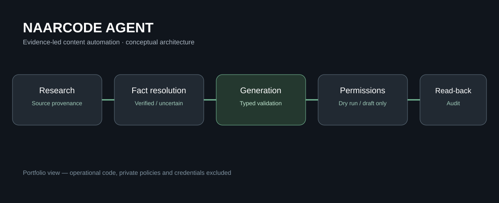

# NaarCode Agent

**A controlled AI-assisted workflow for researching and preparing structured product content.**

**Status: Prototype / v0.2.1 — under active development.** The current implementation focuses on an industrial-product content workflow for a WooCommerce-based platform. It is not a general-purpose social-media publishing agent and has not been validated against a production environment.

[فارسی](README.fa.md) · [Architecture](docs/ARCHITECTURE.md) · [Safety and publication scope](docs/SECURITY.md)

## Why it exists

Product information often arrives as a mix of manufacturer documents, distributor descriptions, incomplete technical specifications, and image references. Preparing a consistent product entry requires source evaluation, fact resolution, editorial checks, and careful control over what an automation may write.

NaarCode Agent separates these responsibilities rather than letting a language model act directly on the commerce system.

## Workflow

1. **Research:** discover and rank technical sources using provenance and trust tiers.
2. **Fact resolution:** distinguish verified, uncertain, unknown, and conflicting facts.
3. **Draft generation:** construct structured copy from verified evidence only.
4. **Validation:** enforce typed schemas and project-specific content rules.
5. **Media preparation:** validate source images, normalize orientation, and prepare WebP assets.
6. **Guarded write:** recheck duplicates; allow a **draft-only** product operation when explicitly authorized.
7. **Read-back and audit:** compare saved fields with the expected payload and retain the task history.

## Engineering approach

- Python 3.12, Typer CLI, Pydantic, SQLite, and HTTP integrations
- Separation of orchestration, skills, providers, policies, and narrow tools
- Deterministic permissions and agent/project/skill kill switches
- Dry-run mode as the conservative default
- OS credential-store integration and secret redaction
- Fail-closed behavior for unknown permissions or unverified facts
- Ambiguous-write recovery and duplicate checks before mutation

## Verification status

The supplied project documentation reports **44 passing automated tests and 86% test coverage** as of September 2026, with external services mocked. Those results are documentation from the supplied development snapshot, not an independently reproduced test run.

**Real external-provider configuration, local/staging acceptance and production validation remain outstanding.** The media acquisition provider has an integration/approval contract, but an autonomous external image discovery service was not configured in this version. The integration includes a candidate REST metadata change that still requires independent schema review.

## Architecture



See [Architecture](docs/ARCHITECTURE.md) for trust boundaries and state transitions.


## Selected source example

A small, source-derived code sample is available: [task state transitions](examples/task_state_machine.py). It illustrates an isolated engineering technique used in the original project. The associated [test file](examples/test_task_state_machine.py) uses synthetic inputs and contains no customer or production data.

```sh
python -m unittest discover -s examples -p 'test_*.py'
```

The example has been separated from the original application and may be lightly adapted for standalone review. **It is not the full product, a deployment package, or a representation of every proprietary module.**

## Repository boundary

This public repository is a **portfolio showcase**, not a runnable distribution. The full agent source, prompts and project-specific policy rules, credentials, private endpoints, and client integrations are not published here.

© NaarCode. All rights reserved. See [Rights](RIGHTS.md).

[naarcode.com](https://naarcode.com/fa)
